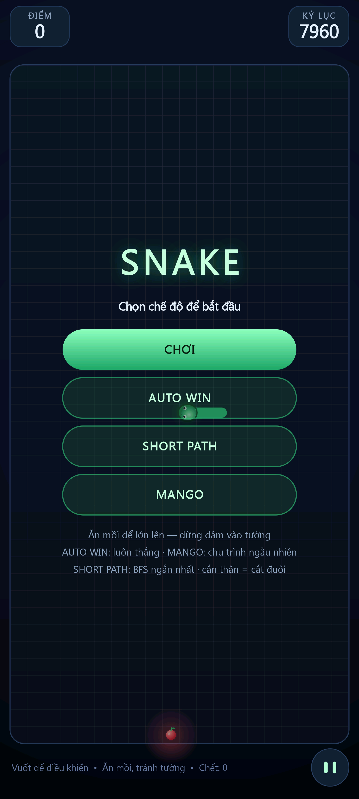
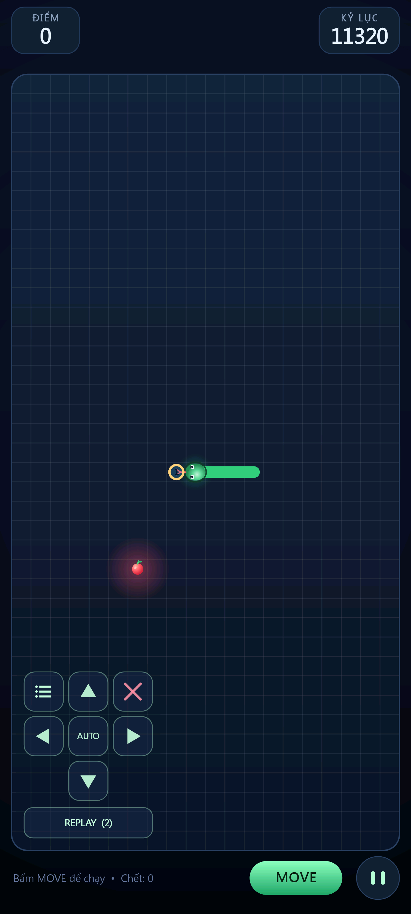

# Snake 2D — Android

Game rắn săn mồi 2D viết bằng Java thuần (Android framework, không dùng AndroidX/Gradle),
vẽ trên `SurfaceView` với render thread riêng và nội suy chuyển động từng khung hình.

**Tải APK:** [bản phát hành mới nhất](https://github.com/tungbuivn/snake-game/releases/latest)
(`snake-2d.apk`, cài trực tiếp, không cần root).

| Menu 4 chế độ | Chế độ chơi theo waypoint |
| --- | --- |
|  |  |

## Tính năng

- **4 chế độ**, 4 nút xếp **theo hàng dọc** trên màn hình bắt đầu:
  1. `CHƠI` — **đi theo waypoint + tự tìm đường**: rắn đứng yên chờ; chạm lên board để
     đặt waypoint (chạm vào waypoint có sẵn để chọn/sửa), hiện **4 phím mũi tên + nút ✕**
     để dịch điểm hoặc xoá; có **đường preview nét đứt mờ** vẽ đúng đường sẽ đi và nút
     **`MOVE`** để rắn chạy theo route (đang chạy thì nút đổi thành `DỪNG`); hết waypoint
     thì rắn tự đứng lại. Chưa bấm `MOVE` thì rắn **không di chuyển**.
     **Chạm waypoint là đủ** — không phải tự vẽ từng bước: mỗi đoạn route được tìm bằng
     **BFS ngắn nhất coi thân rắn là tường** (đuôi đang bỏ đi nên tính là trống), đúng
     thuật toán của các chế độ AI, nên rắn **tự vòng qua thân mình** để tới waypoint;
     preview, bóng ma và cảnh báo `COLLISION` đều tính trên chính đường đó.
     Nút **`PREVIEW`** xem lại route **hiện tại** như một đoạn video (bóng xanh cyan chạy
     trên route, rắn thật đứng yên); thoát replay là chơi tiếp bình thường.
     Nếu **không có đường tới một waypoint** (bị thân rắn bịt kín) thì app đánh dấu
     **`BROKEN`**: dấu ✕ đỏ ngay trên waypoint đó + dòng cảnh báo hồng ở thanh dưới
     (`BROKEN tại #3,#5 • không có đường tới`) để bạn dời điểm hoặc đổi thứ tự.
     Nếu **route đâm vào thân rắn** (mô phỏng cả đuôi di chuyển), app đánh dấu
     **`COLLISION`**: ✕ đỏ + vòng tròn đỏ ngay ô sẽ đâm, kèm dòng hồng
     `COLLISION: route đâm thân ở (x,y) • sửa waypoint`.
     Khi chọn 1 waypoint, app vẽ thêm **bóng rắn màu cam mờ**, **vẽ đè lên trên rắn thật**
     và **luôn đủ chiều dài thân**: đầu ở waypoint, thân đi ngược theo route; nếu route
     ngắn hơn thân thì phần còn lại lấy tiếp từ các đốt hiện có (đuôi thật) — nhờ vậy
     luôn thấy được **đầu và đuôi** sẽ ở đâu để đặt waypoint tiếp theo.
     Waypoint **được phép nằm trên thân rắn hiện tại** (khi rắn bò tới thì đuôi đã đi
     qua, ô đó thường đã trống).
     Nút **`FOLLOW`** (ô dưới-trái cụm phím): rắn **tự tìm đường bám theo đuôi** của mình;
     bấm 1 lần rồi chạm lên **một đốt trên thân** để chọn **điểm dừng** — rắn bám đuôi tới
     khi đầu tới đúng điểm đó thì dừng (bấm lần nữa để chạy bám đuôi không điểm dừng, hoặc
     bấm `STOP` để dừng tay).
  2. `AUTOPLAY` — AI đi **chu trình Hamilton** (boustrophedon cố định) phủ toàn board:
     mỗi tick rắn **chỉ đi tiến trên chu trình**, trong **cung trống giữa đầu và đuôi**;
     quả sinh trong cung đó nên **luôn tới được** và **không bao giờ bị dời**; thân là một
     đoạn liền trên chu trình và chỉ dài thêm khi ăn → cung trống co dần đều → **điền kín
     bàn** = **thắng**, **0 cắn thân, 0 đâm tường**.
     Ba nút toggle đổi biến thể mà **không cần chọn mode**:
     - `SC` — **shortcut an toàn** (mặc định BẬT): cho phép rời chu trình khi rẽ tắt, nhưng
       chạy **rắn ảo `len + 5` bước** trên bản mô phỏng — không tự cắn thì mới đi, và chọn
       hướng có **cost map** (số bước theo chu trình tới quả) nhỏ nhất.
     - `ZZ` — **longer path / zig-zag** khi đầu sát đuôi (thêm khoảng trống cho thân).
     - `RND` — **chu trình ngẫu nhiên**: dựng lại bằng **divide & conquer + merge 2×2**
       (mỗi lần đều `cycleValid`) rồi chơi lại trên chu trình mới.
     Test `WIN RATE`: **20 seed × 4 biến thể × 2 cỡ bàn = 160 ván → 100% thắng, 0 chết**
     (`winTick` TB 20×12: snake 3.448, randmerge 3.930; 20×30: snake 14.236, randmerge 22.500).
     **Vì sao bỏ greedy**: greedy "đường ngắn nhất + bám đuôi" đo được 645 quả/12k tick
     nhưng **tự bịt túi** rồi phải cắn thân (19–38 lần/ván) — không thể chứng minh thắng.
     Spiral/lawnmower dựng động cũng đã thử: spiral là **đường hở**, không khép vòng được
     nên không điền kín bàn (chỉ đạt 10–13/240 ô).
- **Quả sinh ngẫu nhiên, mỗi quả một lần**: chọn 1 ô trống ngẫu nhiên (trong cung trống
  của chu trình → luôn tới được), **không sinh lại liên tục** nên quả không nhấp nháy.
- **Cắn thân = một lần chết nhưng không dừng ván**: khi đầu đâm vào thân (mọi chế độ),
  đoạn thân từ chỗ đâm tới đuôi bị cắt bỏ, bộ đếm **`Chết` tăng 1**, rắn **đổi màu**
  (6 màu luân phiên) và **chạy tiếp**; chỉ đâm tường mới kết thúc ván.
- **AI (AutoPilot)**: hai cách chạy, cùng một bộ máy an toàn (chỉ đi **tiến** trên chu
  trình, trong **cung trống** giữa đầu và đuôi; quả sinh trong cung nên luôn tới được).
  - **`AUTO WIN` — chu trình Hamilton đơn, cố định**: một chu trình boustrophedon phủ
    toàn board; mỗi ván đường đi y hệt nhau. Shortcut BFS trong cung để đi nhanh hơn,
    nước nào **vượt quá quả trên chu trình** thì bị loại (vượt là mất nguyên một vòng) —
    nhờ vậy đầu luôn tiến đều tới quả và ván **không bao giờ thua**.
  - **`MANGO` — chu trình Hamilton ngẫu nhiên**: cũng một chu trình đơn, nhưng chuỗi
    boustrophedon bị “xáo” bằng 250 lượt split + mend (2-opt) nên **mỗi ván một đường
    mê cung mới**; luật đi an toàn y như `AUTO WIN`.
  - Quả chỉ sinh ở ô trống **và còn tới được** (kiểm tra BFS lúc sinh, không sinh lại
    liên tục) nên quả không nhấp nháy mà cũng không bị kẹt sau thân rắn.
  Đo trên máy: **AUTO WIN** 58s: 70 quả, avg 0.85s, 20 lượt cuối avg 0.51s, max 2.8s,
  **100% ≤3s, 0 chết** · **MANGO** 60s: 62 quả, avg 0.93s, 100% ≤3s, 0 chết; chạy dài
  MANGO thắng **798/800 đốt** sau ~480s, 0 chết.
  *Bước tiến đảm bảo* (nhánh chu trình): nước đi **vượt qua quả trên chu trình** bị
  loại (vượt là mất thêm nguyên một vòng); chỉ khi mọi nước đều vượt mới chọn bước
  ngắn nhất — nhờ vậy đầu luôn tiến đều tới quả.

- **Tốc độ đều, KHÔNG gia tốc**: `interval` cố định — **60ms/ô** ở chế độ tự động,
  **110ms/ô** ở chơi tay. Nó chỉ co lại (sàn **32ms**) khi quả còn quá xa, theo ngân
  sách `3000ms / stepsToFood`, để quả tới trong vài giây. **Không còn** gia tốc dần,
  không còn hệ số thích nghi, và **không còn "teleport"** (mỗi khung mô phỏng nhiều
  bước) — chính mấy thứ đó làm hình giật và làm chế độ chậm trông như rắn trượt.
  Ở chế độ chu trình, quả chỉ sinh trong **nửa gần của cung trống** (≤160 bước) nên
  rắn không phải băng hết một vòng mới tới quả.
- **Chiến thắng**: khi không còn ô trống để sinh quả (rắn phủ kín board), game vào
  trạng thái **CHIẾN THẮNG** (thẻ vàng, điểm cuối). Watch-mode tự chơi lại sau 4s.
  Đo trên máy: rắn đạt **800/800 đốt** sau 300s, `state=4`.
- **Rắn vẽ tối giản nhưng có khối 3D**: thân đứng yên trong mỗi tick — chỉ **đầu duỗi ra** ô
  kế tiếp và **đuôi thụt vào**; mọi điểm giữa nằm đúng tâm ô nên **hình học khúc cua cố
  định, vẽ một lần là không thể gợn/phập phồng**. Đường tâm là polyline, khớp cua do
  **ROUND join** tự bo bán kính = nửa bề rộng (không bo tay) nên bề dày luôn hằng số.
  Trên cùng một đường tâm đó vẽ **5 lớp** để thành ống trụ có chiếu sáng từ trên:
  1. **bóng đổ** mềm (đen alpha thấp, lệch +1.6/+2.6dp, rộng hơn thân),
  2. **màu nền** (`#35D07F`),
  3. **mặt dưới tối** (màu trộn đen 62%, dày 0.66×thân, lệch xuống 0.19×thân),
  4. **mặt trên sáng** (trộn trắng 55%, dày 0.36×thân, lệch lên 0.18×thân),
  5. **vạch vảy** bằng `PathMeasure` (dài tối đa 90 vạch, alpha rất thấp).
  Đầu là capsule to hơn thân (0.88×cell) có gradient, **bóng đổ dưới đầu + bóng cằm +
  vệt bóng bóng (specular)**, mắt (đồng tử + ánh sáng), lỗ mũi, mắt X khi thua — **không
  vẽ lưỡi**. Đầu **nội suy mượt** từ ô cũ sang ô mới y như thân (nhờ vậy chế độ chậm không
  còn giật từng ô), **riêng tick ăn quả** thì đặt ngay vào tâm ô quả (nên đầu nằm đúng ô
  quả vừa ăn, không bị tụt lại 1 ô); mũi đuôi cũng nội suy mượt. Đuôi bo tròn đúng bằng
  bề rộng thân.
- HUD: pill `ĐIỂM` / `KỶ LỤC` cao 52dp, nhãn và số tách nhau ~7dp (không dính).
- Mồi táo có quầng sáng, nhấp nháy; hạt hiệu ứng khi ăn; điểm `+10` bay lên.
- Điểm số + kỷ lục lưu `SharedPreferences`, tạm dừng/tiếp tục, overlay kết thúc,
  rung nhẹ (haptic) khi ăn/thua.
- Board tự co giãn theo màn hình: 20 cột, số hàng 12..46. **Dải điều khiển luôn được
  chừa riêng ở dưới grid** (cụm phím waypoint + PREVIEW + `MOVE` + tạm dừng) nên bàn
  phím **không bao giờ đè lên ô chơi**; nhờ vậy máy 1440×3200 ra **20×34** (ô 68px) thay
  vì 20×40 trước đây — grid gọn hơn, chọn điểm dễ hơn. HUD nằm sát mép trên hai bên
  camera cutout. Fullscreen immersive.

## Cấu trúc

```
app/src/main/AndroidManifest.xml
app/src/main/java/com/dsh/snake/MainActivity.java   # fullscreen, lifecycle
app/src/main/java/com/dsh/snake/GameView.java       # game loop, vẽ, input, UI
app/src/main/java/com/dsh/snake/AutoPilot.java      # AI tự chơi
app/src/main/res/...                                # theme, icon vector/adaptive
build.ps1                                           # build APK không cần Gradle
tools/analyze.js, tools/verify.js                   # kiểm tra ảnh chụp màn hình
tools/mango_cycle.js, tools/sim_cycles.js           # kiểm chứng chu trình + mô phỏng AI
tools/eatspeed.js                                   # thống kê tốc độ ăn từ eats.txt
```

## Build & deploy

Yêu cầu: JDK 17+ (`JAVA_HOME`), Android SDK build-tools 35.0.0 + platform android-35,
`adb` với thiết bị đã bật USB debugging. `build.ps1` tìm SDK ở `.android-sdk/` trong repo
(không có thì tự tải về), nên clone mới vẫn build được.

```powershell
# chỉ build
powershell -ExecutionPolicy Bypass -File build.ps1

# build + cài qua adb + chạy
powershell -ExecutionPolicy Bypass -File build.ps1 -Deploy
```

Quy trình trong `build.ps1`:
`aapt2 compile` → `aapt2 link` → `javac` → `d8` → `jar uf` (dex vào apk) →
`zipalign` → `apksigner` (keystore debug tự sinh ở `keystore/`).

APK: `build/snake-2d.apk` (~53 KB, ký bằng debug key — cài trực tiếp được, nhưng nếu
muốn phát hành chính thức trên Play Store thì thay keystore riêng).

### Unit test (không cần JUnit)

```powershell
powershell -ExecutionPolicy Bypass -File tools\test.ps1
```

`tools\test.ps1` biên dịch `app/src/test/java/**` cùng `PathPilot.java` rồi chạy
`com.dsh.snake.PathPilotTest` (25 case: hướng đi, không quay đầu, đuôi trùng ô đầu, đầu bị
bịt kín, sát tường, cứu quả) và cuối cùng **chạy lại 20.000 tick** luật `SHORT PATH` để kiểm
tra: **0 chết vì tường**, mỗi lần cắn thân chỉ xảy ra khi **không còn đường tới quả** (túi
kín), không bao giờ cắn vào cổ, và in ra bảng từng lần cắn (`tick`, `len trước → sau`,
`branch`) để soi nguyên nhân.

> Lưu ý khi sửa file có tiếng Việt: phải đọc/ghi UTF-8. Dùng
> `Get-Content -Raw -Encoding utf8` + `Set-Content -Encoding utf8` (hoặc công cụ
> soạn thảo hỗ trợ UTF-8). Nếu đọc bằng encoding mặc định (ANSI) rồi ghi lại, toàn
> bộ chuỗi tiếng Việt sẽ bị mojibake (`ĐIỂM` → `ÄIỂM`). Có thể kiểm tra/binary
> bằng `tools/checktext.js` và sửa bằng `tools/repair_vn.js`.
>
> Lưu ý khi deploy bằng script/agent: adb server có thể bị kill khi process cha kết thúc.
> Nếu lệnh adb "treo", chạy `adb nodaemon server` trong một background job để giữ daemon,
> sau đó các lệnh adb khác sẽ nối vào daemon đó.

## Điều khiển

| Thao tác | Tác dụng |
| --- | --- |
| Chạm lên board (chế độ `CHƠI`) | Đặt waypoint mới; chạm vào waypoint có sẵn để chọn nó. Rắn **tự tìm đường ngắn nhất** (BFS, thân là tường) tới waypoint đang là mục tiêu |
| 4 phím mũi tên / `✕` | Dịch waypoint đang chọn 1 ô / xoá waypoint đó |
| `AUTO` (giữa 4 mũi tên) | **Tự đặt waypoint an toàn**: lấy đường ngắn nhất đầu→quả (BFS, thân là tường), **mô phỏng ăn xong** rồi kiểm tra **vẫn còn đường bám đuôi**; chỉ khi qua mới đặt route (chỉ giữ **điểm gấp khúc** + quả). Không an toàn thì **tự chuyển sang route bám đuôi** để rắn không chết |
| `LIST` (đối xứng với `✕`) | Mở **hộp thoại danh sách waypoint**: mỗi dòng ghi số thứ tự + toạ độ ô; **kéo-thả dòng** để đổi thứ tự (thả tới đâu là chèn tới đó), chạm 1 dòng để chọn nó, chạm ra ngoài hoặc `✕` để đóng |
| `PREVIEW (n)` (dưới cụm phím) | **Playback route hiện tại như video**: rắn thật **đứng yên**, một bóng rắn **xanh cyan** bò lại đúng các waypoint **đang có** (không lưu lịch sử cũ), có nhãn `PREVIEW i / n`; nút đổi thành **`THOÁT PREVIEW`** — bấm lần nữa hoặc chạm bất kỳ đâu là thoát và **chơi tiếp** đúng chỗ đang đứng |
| `FOLLOW` (ô dưới-trái của cụm phím) | **Bám đuôi**: bấm 1 lần → *chờ chọn điểm* (chạm lên **một đốt trên thân rắn** để đặt điểm dừng); bấm lần nữa → chạy bám đuôi luôn. Rắn tự tìm đường (BFS) **chạy theo đuôi** và **luôn giữ khoảng cách ≥ 2 ô tới đuôi** (để lúc ăn quả, đuôi có dài ra thêm 1 đốt vẫn còn khoảng an toàn mà bám); dừng khi **đầu tới đúng điểm đã chọn**. Nút đổi thành **`STOP`** khi đang chạy |
| `MOVE` / `DỪNG` (thanh dưới) | Cho rắn chạy theo route / dừng lại để sửa |
| `−` / `+` (góc dưới-phải) | **Tốc độ chạy**: mỗi lần bấm đổi 1 nấc `0.5× · 0.75× · 1× · 1.5× · 2× · 3×` (giữa hai nút hiện số hiện tại). Tốc độ chia tick interval nên áp dụng cho **cả chơi tay lẫn AI**, lưu lại cho lần mở sau |
| `RST` / `SC` / `ZZ` / `RND` (hàng trên nút tốc độ) | `RST` = **chơi lại ván hiện tại** (giữ đúng mode CHƠI/AUTOPLAY + thuật toán đang chọn). `SC` = **shortcut an toàn** rời chu trình (mô phỏng rắn ảo `len+5` bước, không cắn thân thì mới đi — ý tưởng từ [perfect-snake-challenge](https://github.com/LPRowe/perfect-snake-challenge)); `ZZ` = **zig-zag / longer path** khi đầu sát đuôi (ý tưởng từ [chuyangliu/snake](https://github.com/chuyangliu/snake)); `RND` = autoplay dùng **chu trình Hamilton ngẫu nhiên** (divide-and-merge các dải, có validate) — bật/tắt sẽ chơi lại ngay trên chu trình mới. **Toggle đang bật được áp dụng ngay lập tức** (SC/ZZ đổi hành vi từ tick kế tiếp, RND đổi chu trình), và trạng thái được ghi vào `state.txt` (`sc=`, `zz=`). Test `AI TOGGLES` xác nhận cả 3 biến thể vẫn điền kín 240/240, 0 cắn, 0 chết tường |
| Menu tạm dừng | `TIẾP TỤC` để chạy tiếp; chạm **AUTOPLAY** = **bật lại AI cho ván đang chơi** (giữ điểm) — kể cả khi bạn vừa chạm badge để giành quyền điều khiển tay |
| Vuốt 4 hướng (chế độ AI) | Chuyển sang tự điều khiển (rắn đứng chờ waypoint) |
| Chạm `CHƠI` / `AUTOPLAY` | Bắt đầu chơi tay (waypoint) hoặc để AI autoplay (2 nút xếp dọc) |
| Chạm `❚❚` (góc dưới phải) | Tạm dừng / tiếp tục |
| Chạm khi thua | Chơi lại; menu có `CHƠI LẠI` · `AUTOPLAY` |

Cụm phím chỉnh waypoint nằm trong **dải điều khiển dưới grid** (không đè lên bàn chơi):
`[[LIST] [▲] [✕]] / [[◀] [AUTO] [▶]] / [[FOLLOW] [▼]]` + nút `PREVIEW (n)` bên dưới,
còn `MOVE` và nút tạm dừng ở bên phải dải này; dòng gợi ý + `Chết: N` ở trên cùng của dải.

HUD hiện `ĐIỂM`, `KỶ LỤC`, badge tên chế độ AI, và thanh dưới có `Chết: N` — mỗi lần
**cắn vào thân** (bị cắt đuôi) hay **đâm tường** đều +1 và đổi màu rắn.

## Kiểm tra nhanh (tuỳ chọn)

App ghi snapshot trạng thái vào `Android/data/com.dsh.snake/files/state.txt`
(state, điểm, fps, quả, chu trình, toạ độ từng đốt và toạ độ vẽ đã nội suy) — dùng cho:

- `tools/eatspeed.js` — thống kê tốc độ ăn (avg/median/p90/max, % lượt ≤3s) từ `eats.txt`.
- `tools/sim_cycles.js` — mô phỏng 4 chế độ trên JS để so sánh các chu trình
  (boustrophedon / 2 dải / MangoSnake ngẫu nhiên, nhiều seed).
- `tools/mango_cycle.js` / `tools/CycleTest.java` — kiểm chứng chu trình ngẫu nhiên
  vẫn là **một chu trình Hamilton duy nhất** trên mọi kích thước board.
- `tools/widths.js` — đo bề rộng thân theo phương vuông góc tại từng đốt và so với
  hàm thuôn dự kiến, để chắc khúc cua không phình (kết quả: `bulges=0`).
- `tools/curvature.js` — tính bán kính cong nhỏ nhất của đường tâm so với nửa bề rộng
  thân (điều kiện đủ để ribbon không tự gấp ở cua).
- `tools/spacing.js` — kiểm tra khoảng cách giữa các đốt (phát hiện thân bị bóp khi cua).
- `tools/verify.js` — đối chiếu ảnh chụp với vị trí rắn thực tế (thân liền mạch).
